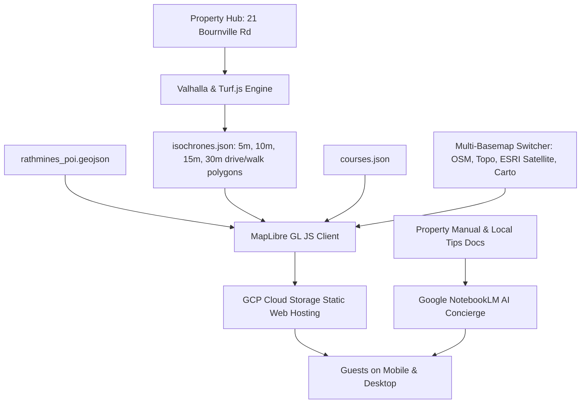

# 📍 Highlight Map Crafter & Spatial Guest Concierge

[](https://opensource.org/licenses/ISC)
[](https://maplibre.org/)
[](https://cloud.google.com/storage)
[](https://notebook.google.com/)
[](#)

> An open-source, serverless interactive map engine and AI-powered guest concierge designed for short-term rentals, boutique accommodations, and local tourism hubs.

---

## 🌟 Overview

**Highlight Map Crafter** bridges the gap between static printed guest binders and generic travel review sites. Built specifically around a property hub (featured at **21 Bournville Road, Rathmines NSW 2283** on Lake Macquarie), it provides visitors with:

- **True Travel-Time Isochrones**: Real drive and walk time polygons calculated via OpenStreetMap / Valhalla routing rather than inaccurate radial circles.
- **Curated Local Insights**: Verified photo galleries, insider tips, waterfront walks, heritage trails, boat ramps, and secret fishing spots.
- **Course Crafter**: Curated itineraries and multi-stop adventures (e.g., *Catalina Heritage Walk*, *Lake Macquarie Sunset Circuit*).
- **AI Guest Concierge**: Deep integration with **Google NotebookLM** to turn house manuals, appliance how-tos, and local guidelines into an interactive, 24/7 conversational assistant.

---

## 🚀 Live Demo & Links

- 🌐 **Live Interactive Map (GCP)**: [https://storage.googleapis.com/rathmines-interactive-map/index.html](https://storage.googleapis.com/rathmines-interactive-map/index.html)
- 📖 **NotebookLM Guest Welcome Manual**: [Google NotebookLM Concierge](https://notebook.google.com/notebook/6e14a441-fc0d-4b66-807e-de61cb59589b)
- 🏡 **Stay With Us (Spatial Retreat)**: [Book at Rathmines on Dibooq](https://rathmines-lakemacquire.book.dibooq.com/)
- 💻 **Source Repository**: [https://github.com/GetBack2Basics/Highlight_Map_Crafter](https://github.com/GetBack2Basics/Highlight_Map_Crafter)

---

## 🏗️ Architecture



---

## ✨ Key Features

| Feature | Description |
| :--- | :--- |
| **🗺️ True Travel Isochrones** | Real-world road and pedestrian network polygons (5, 10, 15, 30 mins) so guests understand realistic travel times across complex lakes and terrain. |
| **🧭 Course Crafter** | Curated step-by-step spatial itineraries with waypoints, distances, elevations, and activity tags. |
| **🛰️ Multi-Basemap Engine** | Seamless switcher between OpenStreetMap Standard, Topo / Terrain (OpenTopoMap), ESRI World Imagery, and CARTO Voyager. |
| **🔍 Category Filters & Search** | Instant client-side filtering for Dining, Coffee, Waterfront Parks, Heritage, Boating, and Hidden Gems. |
| **⚡ Serverless & High Performance** | Zero backend servers required; serves pre-computed GeoJSON and static assets directly via Google Cloud Storage or any CDN. |
| **🤖 AI Welcome Concierge** | Integrated link to Google NotebookLM for instant answers to guest queries on Wi-Fi, check-in, air conditioning, waste management, and local secrets. |

---

## 📂 Project Structure

```text
Highlight_Map_Crafter/
├── data/
│   ├── courses.json                 # Curated spatial itineraries and routes
│   ├── isochrones.json              # Drive and walk time polygon layers
│   ├── rathmines_poi.geojson        # Points of interest with rich metadata & media
│   └── build_geoparquet.py          # Spatial data conversion utilities
├── deploy/
│   ├── deploy_to_gcs.ps1            # Automated PowerShell GCP deployment script
│   └── deploy_to_gcs.sh             # Automated Bash GCP deployment script
├── docs/
│   └── linkedin_post.md             # Launch announcement & social copy
├── scripts/
│   ├── fetch_isochrones.js          # Valhalla routing API fetcher
│   ├── generate_precise_isochrones.js # Polygon smoothing & ring generation
│   ├── generate_smooth_isochrones.js  # Turf.js geometric buffer processor
│   └── update_poi_zones.js          # Spatial join assigning POIs to time zones
├── src/
│   ├── app.js                       # MapLibre application logic & event handlers
│   ├── index.html                   # Core web layout
│   └── style.css                    # UI styles & responsive mobile design
├── app.js                           # Root bundle / development script
├── index.html                       # Entry HTML page
├── package.json                     # NPM dependencies (@turf/turf, etc.)
├── server.js                        # Lightweight local preview server
└── style.css                        # Modern styling with glassmorphism UI
```

---

## 🛠️ Quick Start (Local Development)

### 1. Prerequisites
- [Node.js](https://nodejs.org/) (v18 or higher recommended)
- Git

### 2. Clone & Install
```bash
git clone https://github.com/GetBack2Basics/Highlight_Map_Crafter.git
cd Highlight_Map_Crafter
npm install
```

### 3. Run Locally
```bash
npm start
```
Then open your browser to `http://localhost:3000` (or the port indicated in `server.js`).

---

## 🎨 Adapting for Your Property or Region

Adapting Highlight Map Crafter for your own short-term rental, resort, or tourism organization is straightforward:

1. **Set your Property Hub Coordinates**:
   Update the center coordinates and zoom levels in `src/app.js` (and `app.js`):
   ```javascript
   const HUB_COORDINATES = [151.5878, -33.0483]; // [Longitude, Latitude]
   ```

2. **Add Your Local POIs (`data/rathmines_poi.geojson`)**:
   Add GeoJSON features with your own categories, photos, descriptions, and verified links:
   ```json
   {
     "type": "Feature",
     "geometry": { "type": "Point", "coordinates": [151.589, -33.045] },
     "properties": {
       "name": "Local Coffee Roastery",
       "category": "Cafe",
       "drive_time_zone": "5 min",
       "description": "Best flat white and sourdough pastries in the area.",
       "image": "https://...",
       "google_maps_url": "https://maps.google.com/?q=..."
     }
   }
   ```

3. **Generate Isochrones (`scripts/`)**:
   Use `scripts/fetch_isochrones.js` to compute drive/walk travel-time polygons from your hub using Valhalla or OpenRouteService.

4. **Add Custom Tours (`data/courses.json`)**:
   Define scenic drives, walking tours, or kayak trails with coordinate paths and stop descriptions.

5. **Train Your NotebookLM AI Guide**:
   Upload your house PDF manual, PDF guides, and local recommendations to [Google NotebookLM](https://notebook.google.com/) and link the notebook in your UI header.

---

## ☁️ Deployment to Google Cloud Storage

Deploy the complete static web application to Google Cloud Storage in seconds using the included deployment scripts.

### Using PowerShell (Windows)
```powershell
.\deploy\deploy_to_gcs.ps1 -BucketName "your-custom-bucket-name" -Region "australia-southeast1"
```

### Using Bash (macOS / Linux)
```bash
chmod +x ./deploy/deploy_to_gcs.sh
./deploy/deploy_to_gcs.sh your-custom-bucket-name australia-southeast1
```

The script automatically:
1. Provisions the Google Cloud Storage bucket with uniform bucket-level access.
2. Configures web hosting (`--web-main-page-suffix=index.html`).
3. Sets public read access (`roles/storage.objectViewer` to `allUsers`).
4. Synchronizes HTML, CSS, JavaScript, and GeoJSON assets.

---

## 🤝 Custom Projects & Spatial Consulting

Want a tailored interactive map engine, bespoke isochrone routing, or an AI concierge built for your short-term rental, boutique hotel chain, or regional council?

- 💬 **Get in Touch**: Reach out via GitHub Issues or contact us through our [GetBack2Basics Organization](https://github.com/GetBack2Basics).
- 🏡 **Visit Us**: Come experience it in person at our Lake Macquarie stay — [Book a Spatial Retreat](https://rathmines-lakemacquire.book.dibooq.com/).

---

## 📜 License

This project is licensed under the [ISC License](LICENSE). Feel free to fork, adapt, and build upon it!
